# Certifications portfolio / 수료·자격 포트폴리오

> **Migrated from Quartz wiki** (`wiki/concepts/certifications-portfolio.md`, updated 2026-09-26)  
> tags: certifications, awards, courses  
> source: https://github.com/weedmo/certifications  
> source: raw/2026-09-26-weedmo-certifications/README.md  
> source: raw/2026-09-26-rokey-doosan-bootcamp-repos/  

## English

Living catalog of credentials for [Joonmo Han (weedmo) / 한준모](/area/career/joonmo-han), ingested from [weedmo/certifications / 위드모 수료·자격 저장소](/area/certifications/weedmo-certifications). Certificate images below are rendered from the PDF/JPG originals in the repo snapshot.

### Formal credential

| Name | Ended | Issuer |
|------|-------|--------|
| ADsP | 2025-03-21 | Korea Data Industry Promotion Agency |

### Course / program completions

| Name | Ended | Issuer |
|------|-------|--------|
| Doosan Robotics Bootcamp | 2025-07-05 | Doosan Robotics |
| Neural Networks and Deep Learning | 2025-03-12 | Coursera / DeepLearning.AI |
| Improving Deep Neural Networks | 2025-03-18 | Coursera / DeepLearning.AI |
| Structuring Machine Learning Projects | 2025-03-19 | Coursera / DeepLearning.AI |
| Convolutional Neural Networks | 2025-03-26 | Coursera / DeepLearning.AI |
| Deep Learning Specialization | 2025-04-16 | Coursera / DeepLearning.AI |
| ROS2 Nav2 — SLAM and Navigation | 2025-03-25 | Udemy |
| 2025 Global Leadership Challenge | 2025-02-12 | NSI |
| Automotive middleware SOME/IP | 2024-12-27 | Sungkyunkwan Univ. future automotive talent program |
| Intelligent vehicle (Hyundai NGV) | 2024-12-08 | Hyundai NGV |
| Job competency (control, judgment) | 2024-12-08 | Hyundai NGV |
| Simulink Onramp | 2023-12-07 | MathWorks |

### Awards

| Name | Date | Issuer |
|------|------|--------|
| 2024 Autonomous Driving SW Contest award | 2024-08-16 | Korea Electronics Association |
| 4D Adventure Design Dual-Linking Contest | 2019-11-15 | Dankook University LINK+ |

### Certificate images

#### ADsP (2025-03-21)

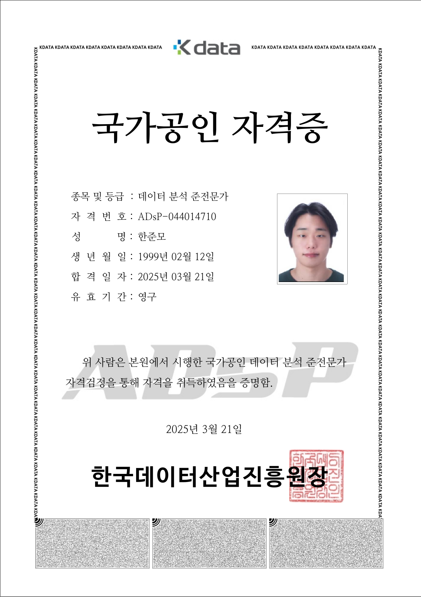

#### Doosan Robotics Bootcamp (2025-07-05)

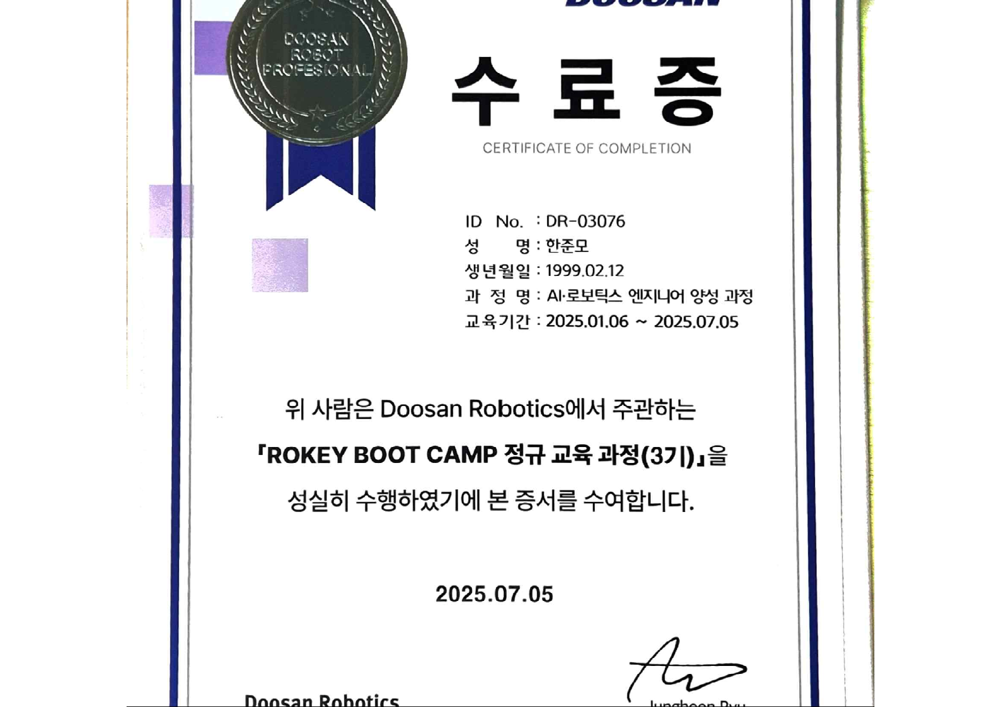

#### Related projects (Doosan / Rokey Bootcamp)

Projects from the Rokey / Doosan Robotics Bootcamp arc (**2025.01–2025.07**) linked to this credential. Hub: [Doosan Rokey Bootcamp / 두산 Rokey 부트캠프](/archive/doosan-rokey-bootcamp/doosan-rokey-bootcamp). Source snapshot: [weedmo Rokey / Doosan bootcamp GitHub repos / weedmo Rokey·두산 부트캠프 저장소 모음](/archive/doosan-rokey-bootcamp/weedmo-rokey-repos).

| Project | Period notes | GitHub |
|---------|--------------|--------|
| [rokey-easy-moveit2 / Rokey MoveIt2 Task Server](/archive/doosan-rokey-bootcamp/rokey-easy-moveit2) | 2025.04–2025.05 (repo description) | https://github.com/weedmo/rokey-easy-moveit2 |
| [ROKEY3_SLAM_robot_system / TurtleBot4 Park Patrol](/archive/doosan-rokey-bootcamp/rokey3-slam-robot-system) | Bootcamp 2025 3rd cohort (README); ~2025-06 | https://github.com/weedmo/ROKEY3_SLAM_robot_system |
| [Rokey_f1_co-op3 / TurtleBot3 Manipulator Digital Twin](/archive/doosan-rokey-bootcamp/rokey-f1-co-op3) | Digital twin co-op; ~2025-04–06 | https://github.com/weedmo/Rokey_f1_co-op3 |
| [Rokey-Collaboration1 / Domino (M0609)](/archive/doosan-rokey-bootcamp/rokey-collaboration1) | Domino / M0609; ~2025-06 | https://github.com/weedmo/Rokey-Collaboration1 |
| [D-Cashier- / Smart cashier cobot](/archive/doosan-rokey-bootcamp/d-cashier) | 2025.06–2025.07 (repo description) | https://github.com/weedmo/D-Cashier- |
| [robo-calligraphy / Manipulator handwriting](/archive/doosan-rokey-bootcamp/robo-calligraphy) | Fork; ~2025-06 | https://github.com/weedmo/robo-calligraphy |
| [Rokey-AI / Rokey AI code & docs](/archive/doosan-rokey-bootcamp/rokey-ai) | Private; 2025-04 | https://github.com/weedmo/Rokey-AI |
| [ROS-study / ROS study materials](/archive/doosan-rokey-bootcamp/ros-study) | Private study; 2025-04–05 | https://github.com/weedmo/ROS-study |

#### Neural Networks and Deep Learning (2025-03-12)

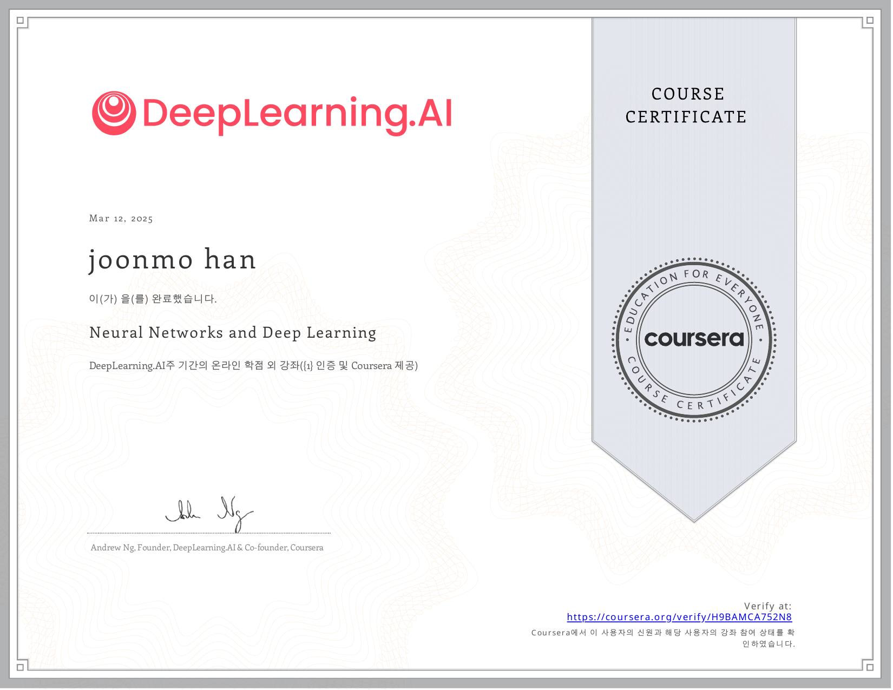

#### Improving Deep Neural Networks (2025-03-18)

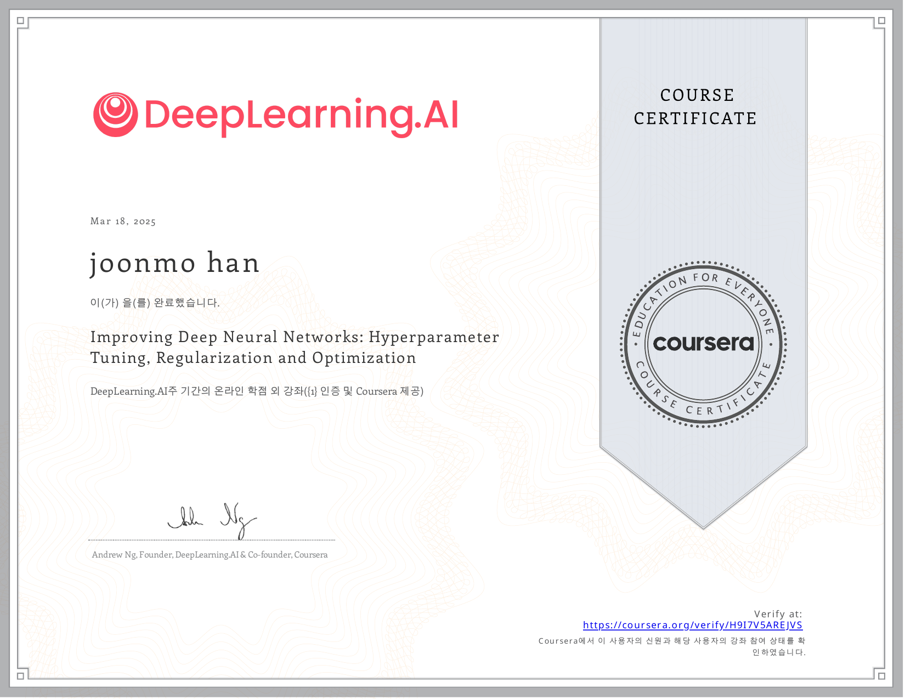

#### Structuring Machine Learning Projects (2025-03-19)

#### Convolutional Neural Networks (2025-03-26)

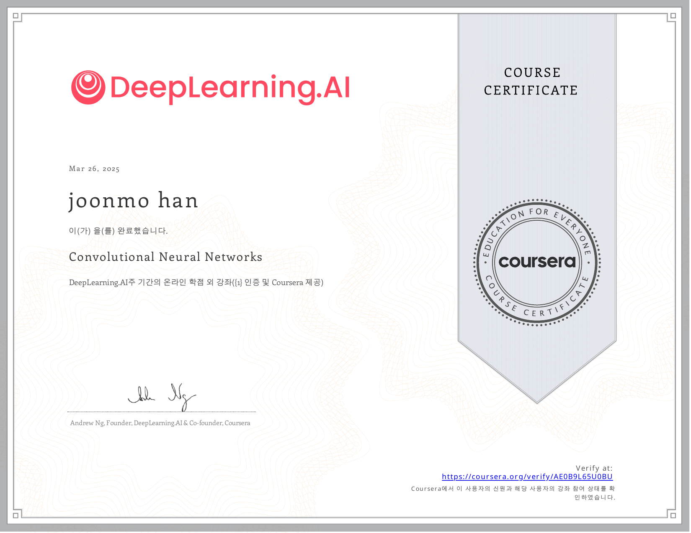

#### Deep Learning Specialization (2025-04-16)

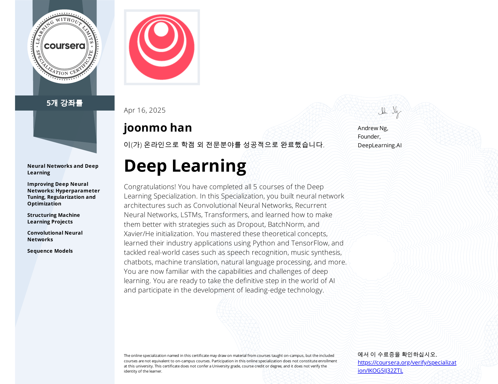

#### ROS2 Nav2 — SLAM and Navigation (2025-03-25)

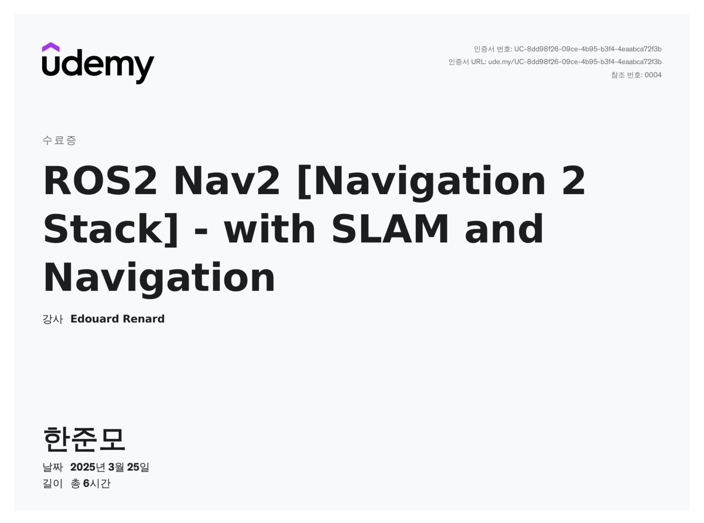

#### 2025 Global Leadership Challenge (2025-02-12)

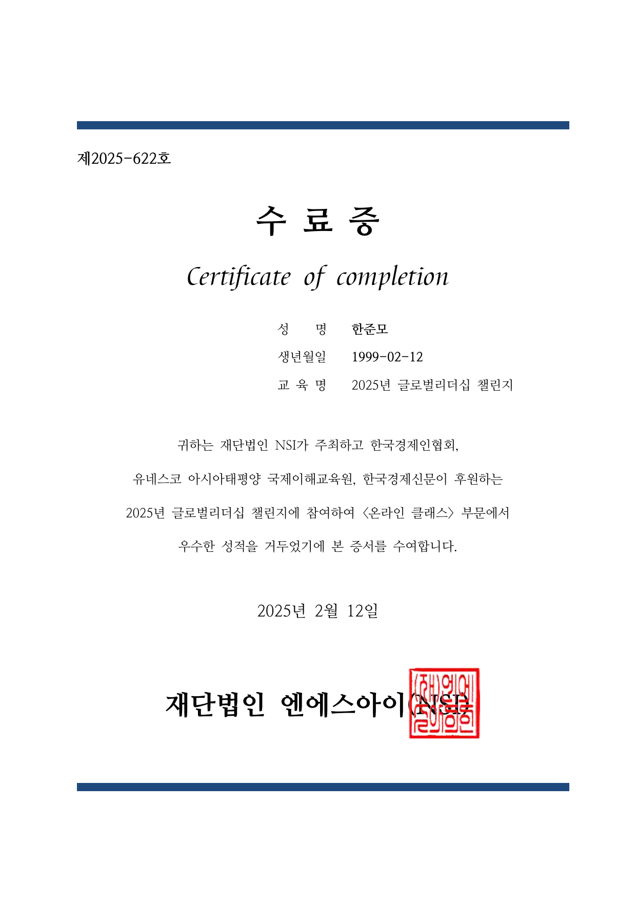

#### Automotive middleware SOME/IP (2024-12-27)

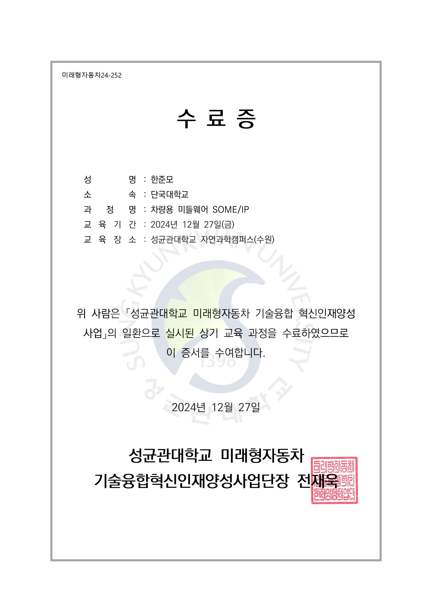

#### Intelligent vehicle (Hyundai NGV) (2024-12-08)

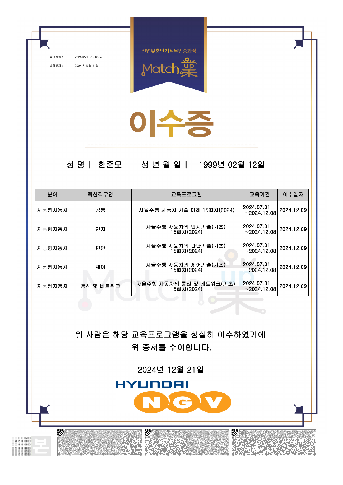

#### Job competency (control, judgment) (2024-12-08)

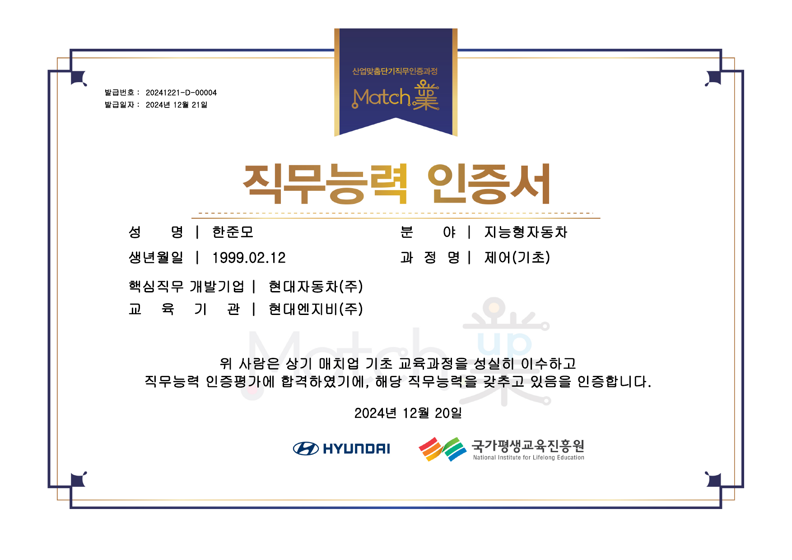

#### Simulink Onramp (2023-12-07)

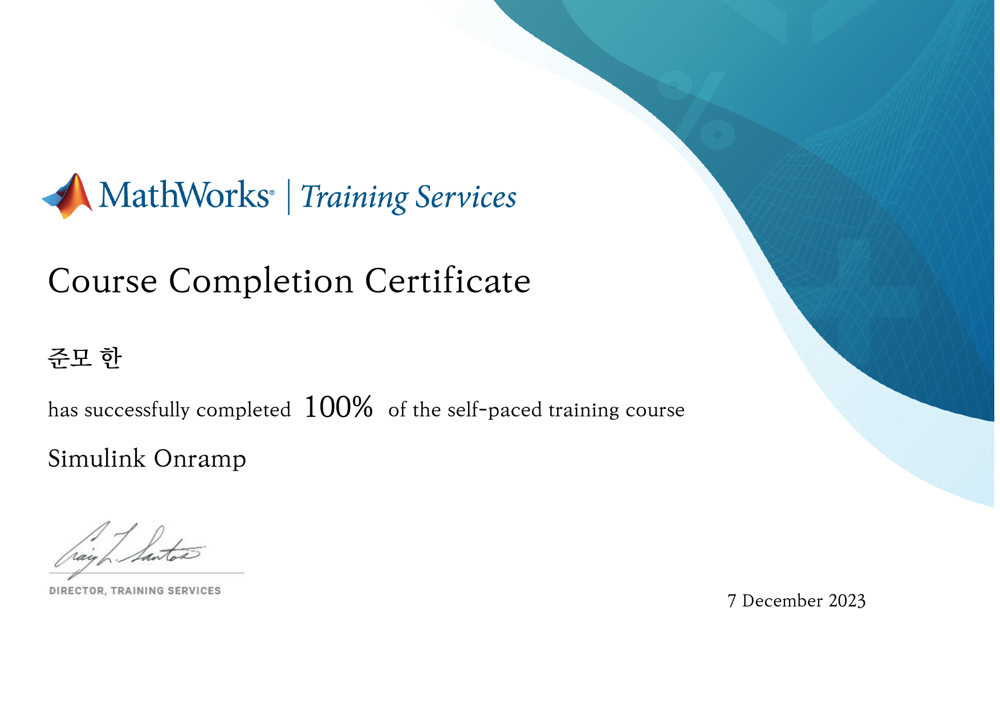

#### 2024 Autonomous Driving SW Contest award (2024-08-16)

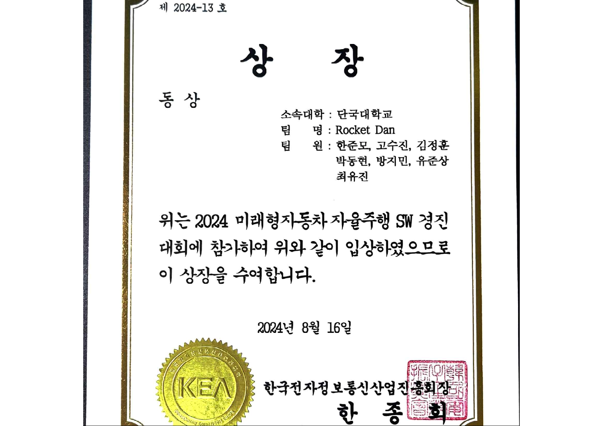

#### 4D Adventure Design Dual-Linking Contest (2019-11-15)

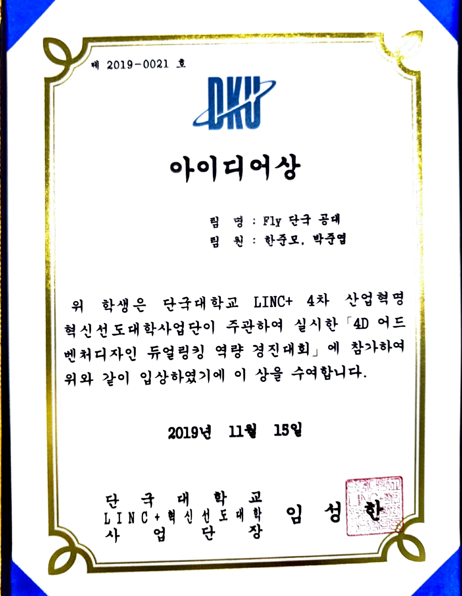

### Themes

- **Autonomy & automotive:** Hyundai NGV, SOME/IP, autonomous-driving SW contest, Simulink
- **Robotics:** Doosan / Rokey bootcamp ([Doosan Rokey Bootcamp / 두산 Rokey 부트캠프](/archive/doosan-rokey-bootcamp/doosan-rokey-bootcamp)), ROS 2 Nav2
- **AI / ML:** DeepLearning.AI specialization course set, ADsP
- **Leadership:** NSI Global Leadership Challenge 2025

## 한국어

[Joonmo Han (weedmo) / 한준모](/area/career/joonmo-han)의 자격·수료·수상 목록. 출처는 [weedmo/certifications / 위드모 수료·자격 저장소](/area/certifications/weedmo-certifications). 아래 이미지는 저장소 스냅샷의 PDF/JPG 원본을 렌더한 것입니다.

### 공식 자격

| 이름 | 종료일 | 기관 |
|------|--------|------|
| ADsP (데이터분석준전문가) | 2025-03-21 | 한국데이터산업진흥원 |

### 과정·프로그램 수료

| 이름 | 종료일 | 기관 |
|------|--------|------|
| 두산 로보틱스 부트캠프 | 2025-07-05 | Doosan Robotics |
| Neural Networks and Deep Learning | 2025-03-12 | Coursera / DeepLearning.AI |
| Improving Deep Neural Networks | 2025-03-18 | Coursera / DeepLearning.AI |
| Structuring Machine Learning Projects | 2025-03-19 | Coursera / DeepLearning.AI |
| Convolutional Neural Networks | 2025-03-26 | Coursera / DeepLearning.AI |
| Deep Learning Specialization | 2025-04-16 | Coursera / DeepLearning.AI |
| ROS2 Nav2 — SLAM and Navigation | 2025-03-25 | Udemy |
| 2025 글로벌 리더십 챌린지 | 2025-02-12 | NSI |
| 차량용 미들웨어 SOME/IP | 2024-12-27 | 성균관대 미래형자동차 기술융합혁신인재양성사업단 |
| 지능형자동차 (Hyundai NGV) | 2024-12-08 | Hyundai NGV |
| 직무능력인증서 (제어, 판단) | 2024-12-08 | Hyundai NGV |
| Simulink Onramp | 2023-12-07 | MathWorks |

### 수상

| 이름 | 일자 | 기관 |
|------|------|------|
| 2024 미래형 자동차 자율주행 SW 경진대회 상장 | 2024-08-16 | 한국전자정보통신산업진흥회장 |
| 4D 어드밴처 디자인 듀얼링킹 역량 경진대회 | 2019-11-15 | 단국대학교 LINK+ 혁신선도 대학 사업단장 |

### 수료증·자격 이미지

#### ADsP (데이터분석준전문가) (2025-03-21)

#### 두산 로보틱스 부트캠프 (2025-07-05)

#### 관련 프로젝트 (두산 / Rokey 부트캠프)

이 수료와 연결되는 Rokey / 두산 로보틱스 부트캠프 구간(**2025.01–2025.07**) 프로젝트. 허브: [Doosan Rokey Bootcamp / 두산 Rokey 부트캠프](/archive/doosan-rokey-bootcamp/doosan-rokey-bootcamp). 소스: [weedmo Rokey / Doosan bootcamp GitHub repos / weedmo Rokey·두산 부트캠프 저장소 모음](/archive/doosan-rokey-bootcamp/weedmo-rokey-repos).

| 프로젝트 | 기간 메모 | GitHub |
|----------|-----------|--------|
| [rokey-easy-moveit2 / Rokey MoveIt2 Task Server](/archive/doosan-rokey-bootcamp/rokey-easy-moveit2) | 2025.04–2025.05 (저장소 설명) | https://github.com/weedmo/rokey-easy-moveit2 |
| [ROKEY3_SLAM_robot_system / TurtleBot4 Park Patrol](/archive/doosan-rokey-bootcamp/rokey3-slam-robot-system) | Bootcamp 2025 3기 (README); ~2025-06 | https://github.com/weedmo/ROKEY3_SLAM_robot_system |
| [Rokey_f1_co-op3 / TurtleBot3 Manipulator Digital Twin](/archive/doosan-rokey-bootcamp/rokey-f1-co-op3) | 디지털 트윈 협업; ~2025-04–06 | https://github.com/weedmo/Rokey_f1_co-op3 |
| [Rokey-Collaboration1 / Domino (M0609)](/archive/doosan-rokey-bootcamp/rokey-collaboration1) | 도미노 / M0609; ~2025-06 | https://github.com/weedmo/Rokey-Collaboration1 |
| [D-Cashier- / Smart cashier cobot](/archive/doosan-rokey-bootcamp/d-cashier) | 2025.06–2025.07 (저장소 설명) | https://github.com/weedmo/D-Cashier- |
| [robo-calligraphy / Manipulator handwriting](/archive/doosan-rokey-bootcamp/robo-calligraphy) | Fork; ~2025-06 | https://github.com/weedmo/robo-calligraphy |
| [Rokey-AI / Rokey AI code & docs](/archive/doosan-rokey-bootcamp/rokey-ai) | Private; 2025-04 | https://github.com/weedmo/Rokey-AI |
| [ROS-study / ROS study materials](/archive/doosan-rokey-bootcamp/ros-study) | Private 학습; 2025-04–05 | https://github.com/weedmo/ROS-study |

#### Neural Networks and Deep Learning (2025-03-12)

#### Improving Deep Neural Networks (2025-03-18)

#### Structuring Machine Learning Projects (2025-03-19)

#### Convolutional Neural Networks (2025-03-26)

#### Deep Learning Specialization (2025-04-16)

#### ROS2 Nav2 — SLAM and Navigation (2025-03-25)

#### 2025 글로벌 리더십 챌린지 (2025-02-12)

#### 차량용 미들웨어 SOME/IP (2024-12-27)

#### 지능형자동차 (Hyundai NGV) (2024-12-08)

#### 직무능력인증서 (제어, 판단) (2024-12-08)

#### Simulink Onramp (2023-12-07)

#### 2024 미래형 자동차 자율주행 SW 경진대회 상장 (2024-08-16)

#### 4D 어드밴처 디자인 듀얼링킹 역량 경진대회 (2019-11-15)

### 테마

- **자율·자동차:** Hyundai NGV, SOME/IP, 자율주행 SW 경진대회, Simulink
- **로보틱스:** 두산 / Rokey 부트캠프 ([Doosan Rokey Bootcamp / 두산 Rokey 부트캠프](/archive/doosan-rokey-bootcamp/doosan-rokey-bootcamp)), ROS 2 Nav2
- **AI / ML:** DeepLearning.AI 코스 세트, ADsP
- **리더십:** NSI 글로벌 리더십 챌린지 2025
